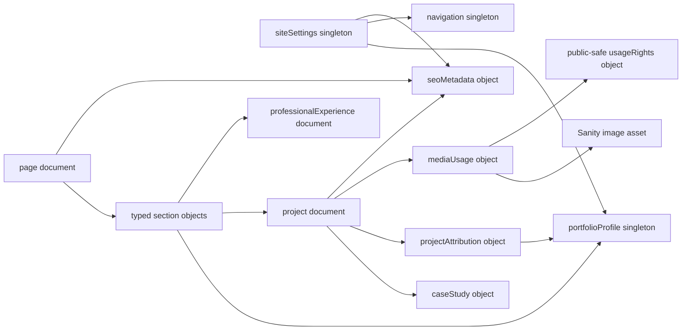

# Sanity content architecture — ALD-114

Status: **proposal for review, not implemented**. Inspected 15 October 2026 at main `88532ad18215c064a14e2824ec9f90b0e513d482`. Target identifiers confirmed by the user: project `p9xrr86a`, dataset `production`. Dataset visibility, exact roles, CORS and credential policy remain **Pending manual verification**. This document grants no write, merge or deployment authority.

## Confirmed repository versus proposed architecture

| Confirmed finding | Source | Proposed response |
| --- | --- | --- |
| Four project cards and four matching case studies are separate structures | `src/content/site.ts`: `projects`, `caseStudies` | One `project` document with embedded `caseStudy` object; maintain separate card and narrative summaries. |
| Four hardcoded case-study route wrappers share a layout | `src/pages/work/{dazlab,mortar,handl,tangilla}.astro`, `CaseStudyLayout.astro` | Later replace wrappers with one static `[slug].astro` template after route parity approval. No route change in ALD-114. |
| Seven year-only experience records used twice | `site.ts`: `experience`; `ExperienceTimeline.astro`; homepage/About | Seven referenced documents; retain year precision, wording and order. |
| Metadata, nav, services and workflow are data; hero/About/contact copy also lives inline in templates | `site.ts`, pages and components | Shared semantic data plus bounded section objects; no arbitrary page-builder CSS/HTML. |
| Canonical origin is `https://example.com`; layout derives noindex from that placeholder | `astro.config.mjs`, `BaseLayout.astro`, `robots.txt` | Keep origin and indexing under code/release control. CMS cannot authorize launch. |
| PR #8 is open at `74df036407c8e19dd23970fb9f9c463369d158b5` | PR #8 setup/security documents and reviewed source | Compatible with its standalone `studio/` and empty schema registration; no cherry-pick or Studio modification here. |

PR #7 (Sprint 1) is also unmerged and excluded. Its copy/layout changes are not this mapping baseline. ALD-115 sign-in/four-area access is user-confirmed; it does not prove remote access policy. Mapping literals are repository facts, not independent proof of every professional claim.

## Model boundaries

Use reusable **objects** for document-owned SEO, links, rich text and sections. Use **documents/references** for independently edited projects, experience and the profile. Do not create a second independently published caseStudy document: a single project revision must keep its card, credit and case-study content coherent. No generic customer/company/product database is needed for four marketing websites.

### Conventions applying to every model

- Tables use **R** = required before publish; **O** = optional; **C** = conditionally required. Drafts can be incomplete. Required missing facts are not filled with guesses.
- Ordinary document IDs are Sanity-generated; singleton IDs alone may be controlled explicitly (`siteSettings`, `portfolioProfile`, `navigation-primary`). Use a stable `migration.sourceKey` and saved ID manifest for repeatable later import, not slug-derived IDs. References resolve actual returned IDs. The schema guidance's generated-ID rule takes precedence over the generic migration skill's deterministic-ID default; repeatability comes from a unique source key, manifest and collision checks.
- Objects in arrays retain stable `_key`; ordering is explicit. English-only baseline (`en`), no invented translations/history or fabricated publication dates.
- Shared document envelope: `migration` O object (`sourceSystem` R string, `sourceKey` R string, `sourceCommit` R string, `sourceLocations` R string[], `legacyPath` O string); `editorialReview` R public-safe object (`state` R enum `needsReview/approved`, `publicWarnings` O string[]). These are workflow aids, not security controls. Actual approval evidence and access policy live in a protected review system, not a potentially public dataset.
- No HTML/JavaScript/CSS, arbitrary JSON-LD, secret settings or private resume/contact data in editable fields. Plain text remains plain text unless a field is explicitly Portable Text. External URLs allow HTTPS only; internal links have a separate type.
- Future schemas must validate in Studio **and** independently in migration/build tooling: API mutations do not automatically enforce Studio schema validation. Published references must resolve to published, approved targets; a missing required reference fails the build.

## Reusable core models

### `siteSettings` — core singleton document

Purpose: shared public identity and metadata defaults, not infrastructure controls.

| Field | Type / requirement | Validation, relationship and editorial guidance |
| --- | --- | --- |
| `siteName` | string R | Existing `siteMetadata.name`; do not embellish professional claims. |
| `language` | string R | `en` for migration; validate supported-language allowlist. |
| `defaultSeo` | seoMetadata R | Exact current default title/description/image; language inherited. |
| `profile` | reference → portfolioProfile R | Required for this portfolio extension; reusable core sites may omit profile. |
| `primaryNavigation` | reference → navigation R | Published target; same nav used by header/mobile/footer initially. |
| `brand` | object R: `shortName` string R, `avatarText` string R, `avatarLabel` string R | Preserve “Aldrin C.” / “AC” / “About Aldrin”; link routes remain semantic references. |
| `footerText` | string R | Preserve existing © 2025 wording; copyright-year policy is an open editorial decision, not auto-updated on import. |

Publication: singleton changes affect every route and require preview-wide review. Canonical origin, Netlify settings, noindex release gate, security headers and secrets are deliberately **not** editable fields.

### `seoMetadata` — core embedded object

| Field | Type / requirement | Validation and rendering |
| --- | --- | --- |
| `title` | string R | Exact initial title; soft length warning around 60 characters, no destructive truncation. |
| `description` | text R | Exact current description; soft length warning around 160, factual parity required. |
| `socialImage` | mediaUsage O | Falls back to site default; image rights/alt review applies. |
| `indexingRequest` | enum `inherit/noindex` R | May make a page more restrictive only; never overrides environment noindex. |

Do not store canonical URLs independently or raw JSON-LD. Derive URL from reviewed origin + route. Typed templates generate the existing Person, WebSite, CollectionPage, AboutPage, ContactPage, CreativeWork and BreadcrumbList shapes. Author means author of the case study; credit remains Dazlab, subject remains Thing. Do not introduce Product/SoftwareApplication ownership, reviews, ratings, dates or metrics.

Publication: owned by parent revision. `title`/`description` may not silently fall back when required page content is missing; defaults apply only where the source already uses them.

### `navigation` — core singleton document; `link` — core object

| Field | Type / requirement | Validation / relationship |
| --- | --- | --- |
| `title` | string R | Internal editor label, e.g. Primary navigation; not a new public heading. |
| `items` | ordered link[] R | Initial five items; no duplicates or empty labels. |
| `link.label` | string R | Preserve current capitalization and arrows where visible. |
| `link.kind` | enum `internal/external` R | Exactly one destination mode. |
| `link.target` | reference → page/project C | Required internal destination; resolve published path. |
| `link.fragment` | string O | Without `#`; matches a rendered stable section anchor; preserve `workflow`/`expertise`/`work`. |
| `link.externalUrl` | url C | Required external HTTPS destination; reject script/data/protocol-relative URLs. |
| `link.newWindow` | boolean R | External true preserves noopener/noreferrer behavior; internal false. |

System destinations `/`, `/work/`, `/about/`, `/contact/` are reserved. An initial migration adapter may preserve an internal `legacyPath` in migration metadata until reference resolution; do not render unchecked arbitrary paths. Publication validates every target and fragment, including header/mobile/footer together.

### `page` — core document

| Field | Type / requirement | Validation / editorial guidance |
| --- | --- | --- |
| `title` | string R | Internal descriptive label; not automatically an additional h1. |
| `routeKey` | enum `home/about/work/contact` R | Unique; maps to fixed existing path. No catch-all pages/system routes initially. |
| `seo` | seoMetadata R | Current per-route values from templates. |
| `sections` | ordered typed section[] R | Template-specific allowlist and required sections; preserve order and one h1. |

Four initial page documents. Contact success, 404, form discovery, robots and sitemap remain system-owned in code. Unpublishing a required core page/settings/profile/navigation causes a failed build; it must not silently remove the contact page or serve empty global navigation.

### Reusable section objects — core patterns, portfolio-specific composition

All carry `anchor` O validated unique fragment, `eyebrow` O string, `heading` C string (required for visible headed sections), `description` O text. Design classes, heading rank, color, spacing, animation timing and responsive rules stay in components, not CMS.

| Section type | Fields and rules | Classification / publish requirements |
| --- | --- | --- |
| `heroSection` | `introLabel` R string; `leftHeading/rightHeading` R strings; `leftText/rightText` R text; `leftLink/rightLink` R link; `portrait` R mediaUsage; `actions` R link[] | Portfolio composition over core hero pattern. Preserve split reveal hook and text structure; no editor animation controls. |
| `textSection` | `paragraphs` R text[] OR `body` R Portable Text (one mode); ordered paragraphs; approved links/emphasis only | Core; initial plain paragraphs maintain fidelity, no raw HTML import. |
| `featureListSection` | `items` R `{title:string R,text:text R}[]`; ordered, unique keys; `actions` O link[] for adjacent approved CTA | Core pattern for services, workflow and contact inquiry/working-together items; numbering derived from order. |
| `ctaSection` | `body` O text; `actions` R link[] | Core; at least one valid destination. |
| `projectCollectionSection` | `selection` R ordered project references; `labels` O string[] for current decorative category chips | Portfolio. Current categories are noninteractive spans, not functional filters. Initial count derived from eligible records; labels kept verbatim. |
| `profileSection` | `profile` R reference; `variant` R enum `summary/biography`; `portrait` O mediaUsage | Portfolio; use profile's corresponding copy, no free duplicate employment claims. |
| `experienceSection` | `entries` R ordered professionalExperience references | Portfolio; same seven-record order in home/About. |
| `toolsSection` | `heading` R string; `items` R `{name:string R,logo:mediaUsage O,wordmark:string C}[]`; wordmark required without logo | Portfolio; usage claims require confirmation, logos require rights review. Duplicate marquee track is rendering only, not duplicate CMS items. |

Shared sections are initially embedded, with profile/projects/experience references providing real reuse. If an independently edited repeated section emerges later, propose a `sharedSection` document then; do not introduce reference indirection for every one-off paragraph. No full visual page-builder in ALD-116's first implementation.

## Portfolio-specific models

### `portfolioProfile` — portfolio singleton document

| Field | Type / requirement | Validation / editorial guidance |
| --- | --- | --- |
| `name` | string R | Aldrin Camacho; public professional name only. |
| `professionalTitle` | string R | Webflow Developer & Digital Experience Specialist; preserve display and JSON-LD conjunction variants through adapter. |
| `summaryParagraphs` | text[] R | Home About block, verbatim; separate biography wording retained. |
| `biographyParagraphs` | text[] R | About story, verbatim; year-only Dazlab history. |
| `profileHeading` | string R | “Design-minded. Development-focused.”; renderer retains line break/accent treatment. |
| `socialLinks` | link[] R | Existing LinkedIn; ownership verification pending, no invented socials. |
| `heroPortrait` / `aboutPortrait` | mediaUsage R / R | Separate assets/alt/crop; provenance/likeness rights not inferred. |
| `experience` | ordered reference[] → professionalExperience R | Shared ordering; no duplicates. |

Publication: identity/claim changes require owner fact review. Does not store address, private email, phone, account credentials or a full private resume.

### `professionalExperience` — portfolio document

| Field | Type / requirement | Validation / guidance |
| --- | --- | --- |
| `company` | string R | Exact company name, not a newly invented company reference. |
| `role` | string R | Exact confirmed role label. |
| `startYear` / `endYear` | integer R / R | Four-digit years, end ≥ start; preserve confirmed historical ranges. No datetime/date/month conversion. |
| `datePrecision` | enum `year` R | Renderer uses en dash. Do not infer current employment from 2026. |
| `description` | text R | Preserve approved source; no new metrics/responsibilities. |

Seven initial records; order comes from profile/experienceSection references, not unreliable date sorting. Publication requires owner-confirmed dates and role; ALD-101's confirmed resume ranges are migration evidence, not permission to invent months.

### `project` document and embedded `caseStudy` object — portfolio

| Field | Type / requirement | Validation / relationship |
| --- | --- | --- |
| `title` | string R | Existing project name. |
| `slug` | slug R | Unique across published/draft logical project IDs; lowercase `[a-z0-9]+(?:-[a-z0-9]+)*`; reserved `index`, `new`, `preview`, `success` disallowed. Locked after first approved publication. |
| `externalUrl` | url R | Existing HTTPS marketing-site URL; verification date not fabricated. |
| `cardRole` | string R | Preserve current `projects[].role` even though ProjectCard currently does not render it. |
| `tags` | ordered string[] R | Preserve existing three tags; no new capability claims. |
| `cardSummary` | text R | Separate from study summary; exact source. |
| `cardImage` | mediaUsage R | Current card asset/alt and top crop; rights gate applies. |
| `attribution` | projectAttribution R | Dazlab credit and Webflow marketing-site scope mandatory for current four. |
| `caseStudy` | caseStudy R | Owned by project; no independently published conflicting narrative. |
| `portfolioStatus` | enum `provisional/verified` R | Initial provisional; Sanity availability alone does not verify facts/rights. |
| `projectYear` | integer O | Initially unset for all four. Not inferred from employment date or asset timestamp. |

`caseStudy` fields: `eyebrow` string R; `heading` string R; `summary` text R; `heroImage` mediaUsage R; `sections` ordered `{heading:string R,body:Portable Text R}[]` R for context narrative; `publicNotices` text[] R for provisional entries; `seo` seoMetadata R. Initial Context text becomes one Portable Text paragraph. “My contribution” and “Scope and credit” text live only in attribution's contributionSummary/scopeStatement, rendered after Context with existing fixed heading labels; do not duplicate them as independently editable narrative paragraphs. Preserve all three rendered sections in order. Only approved inline marks/HTTPS/internal links; no arbitrary embeds, tables, executable markup or unsubstantiated outcomes.

Source detail tuples are **not** a second editable attribution system: render “Project credit / My role / Scope / Status” from attribution + portfolioStatus using the existing labels and exact initial values. `caseStudy.title` and URL are merged with project title/externalUrl only after equality checks. Related-work order remains source project order excluding current project, first two; page adapter retains Next Work labels.

Publication: project-level validation plus external review gate over content revision and rights status; previews may show drafts only behind authenticated access. A newly approved fifth document adds a route through the future dynamic template, without a new file. See [workflow](SANITY_EDITORIAL_WORKFLOW.md).

### `projectAttribution` / contribution — portfolio object

| Field | Type / requirement | Validation / guidance |
| --- | --- | --- |
| `person` | reference → portfolioProfile R | Case-study author/contributor identity, not SaaS owner. |
| `deliveryCredit` | string R | **Dazlab** for all current four projects. |
| `role` | string R | **Sole Webflow developer** for current four. |
| `scope` | enum `marketingWebsite` R | Render “Marketing website”; no product engineering claim. |
| `contributionSummary` | text R | Preserve “My contribution” source paragraph. |
| `scopeStatement` | text R | Preserve “Scope and credit” paragraph and screenshot disclaimer. |
| `capabilities` | ordered `{name:string R,applicability:enum confirmed/contextOnly R}[]` O | Optional future structured breakdown only with per-project evidence. Global CMS/Figma/SEO/AEO responsibilities must not become “implemented on every project.” Leave unset initially. |

No metrics, testimonials, revenue or conversion fields are needed in this first schema. Future additions require evidence provenance and separate review. Existing screenshot claims are third-party content, not achievements attributable to Aldrin.

### `mediaUsage` / `usageRights` — reusable core objects with portfolio review flags

| Field | Type / requirement | Validation / guidance |
| --- | --- | --- |
| `image` | Sanity image R | Asset reference, hotspot support; approved original only. Asset existence ≠ permission. |
| `alt` | string C | Required for informative images; empty only with `decorative=true`. Alt belongs to usage, not global asset title. |
| `decorative` | boolean R | Logos duplicated for marquee decoration may be empty-alt; accessible tool names remain separately available. |
| `caption` | text O | Public-safe and substantiated only. |
| `cropIntent` | enum `cardTop/fullScreenshot/portrait` R | Renderer-controlled preset; preserve current top crop/full study behavior. |
| `legacyAssetPaths` | string[] O | Source manifest paths for dedupe/parity, not hotlinked production output. |
| `rights.status` | enum `unreviewed/approved/restricted/rejected` R | Current screenshots/portraits/logos start unreviewed, not approved. |
| `rights.creditLine` | string O | Only evidenced required attribution; delivery credit is separate. |
| `rights.publicNote` | text O | Current provisional notices safe for public rendering. No confidential contracts, messages or personal details. |
| `reviewFlags` | enum[] R | `testimonials/metrics/dashboard/thirdPartyLogo/portrait/provenanceUnknown`; source concerns recorded below. |

Permission evidence, reviewer identity and revision-bound approval records belong in a protected review ledger/store until dataset privacy and roles are proven. Do not upload confidential proof or sensitive/unredacted media to a potentially public dataset. Publishing a public-safe status field does not itself enforce permission: build/release checks must consult protected approval evidence. Unknown rights block **new CMS publication/cutover by default**. Existing provisional static images remain untouched. Any proposed carry-forward exception needs explicit owner/rights review; ALD-101's temporary retention is not a license or blanket CMS publication approval.

## Asset and security policy

- Preserve PR #6's local optimized WebP/font delivery first. Later asset migration uses originals once, deduped by checksum; generated card/study variants are derived output, not independent assets. Dazlab's two PNGs are byte-identical per generator and should share a source asset with separate usage metadata.
- Current card variants: 480/800/1200, top 16:10 crop, quality 90; study variants: 480/960/1440/1920, full source, rendered top-aligned with max-height 720px; hero variants: 320/512, high fetch priority, eager. About uses Astro Image widths 420/640/820, quality 88. Preserve dimensions/srcset/sizes, lazy cards, async decoding and intentional display crops. Never replace originals with tiny legacy WebPs.
- Prefer a future **build-time local image pipeline** producing hashed files under existing policy, so browsers do not need new Sanity CDN CSP permissions. ALD-117 must evaluate remote fetching/optimization safety and dependency remediation first. Direct CDN delivery is an alternative requiring separate CSP/cache/visual review; no header change now.
- Mortar: metrics, savings/pricing, testimonial. Tangilla: metrics/uptime/implementation claims, testimonials and dashboard graphics. Handl: financial/dashboard examples, integration logos, founder portrait/pricing. Dazlab: dashboard mockups, third-party imagery/logos. Portrait likeness/provenance and tool-logo usage remain unresolved. These are ALD-101 documented concerns, not newly certified visual findings.
- Public website projections contain only reviewed public content. Projection omission is **not** access control for public Content Lake data. Keep secrets, private personal information, approval proofs and sensitive drafts out of potentially public storage; dataset visibility is unresolved. Public Sanity asset URLs must not be treated as confidential storage.
- Restrict edit and publish separately where actual plan supports it; owner retains administration, build integration gets read-only least privilege. No token in `PUBLIC_*`, `SANITY_STUDIO_*`, browser bundles, commits or logs. No browser draft token. No wildcard credentialed CORS. Details in workflow.

## Open decisions for audit (not requests for PC interaction)

1. Approve one project + embedded caseStudy, four fixed page documents and bounded section allowlist; no general page builder.
2. Confirm default rights gate versus an explicitly documented temporary legacy carry-forward exception. No permission/endorsement is inferred.
3. Verify actual Sanity plan/roles, dataset visibility, read-only build and draft-preview access, CORS/token policy: **Pending manual verification**. If server-enforced contributor/publisher separation is unavailable, restrict publishing to the owner; do not pretend a hidden Studio action is authorization.
4. Approve protected review ledger location and revision-based release snapshot; choose authenticated preview platform before any draft rendering. No credentials needed for this documentation task.
5. Choose local build-time Sanity image ingestion versus reviewed CDN policy; remediate ALD-115/independent Astro advisories before release.
6. Preserve footer 2025 until owner separately approves a year policy; confirm tool usage, LinkedIn ownership, detailed per-project capabilities and project dates later.
7. Resolve ALD-109 production integration gate independently; architecture docs do not authorize deployment or launch.

Next implementation boundaries: ALD-116 schemas/validation, ALD-117 typed queries/dynamic routes and static adapter, ALD-118 reviewed draft migration/parity, ALD-119 protected preview/publish/build/rollback QA. No implementation in ALD-114.
