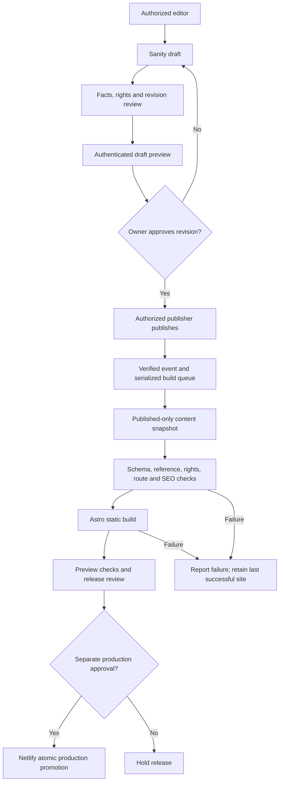

# Editorial, publishing and static rendering proposal

ALD-114 architecture only, 15 October 2026. No schema, CMS mutation, build hook, token, role, Netlify setting or deployment has been configured. Current site remains the static main baseline at `88532ad18215c064a14e2824ec9f90b0e513d482`. Read with [content architecture](SANITY_CONTENT_ARCHITECTURE.md) and [migration mapping](SANITY_MIGRATION_MAPPING.md).

## Current behavior and desired workflow

Current behavior: GitHub PR/push-to-main workflow runs root Astro build/check; Netlify's existing Git integration produces static output. There is no Astro Sanity client or CMS build trigger. ALD-109's automatic production deployment discrepancy remains an independent unresolved gate; do not assume webhook work fixes it. PR #8 provides only a separate local Studio; its schema list is empty. Normal sign-in was user-confirmed, account-level controls were not independently verified.



This is the proposed **future release** sequence, not an assertion that the current account/Netlify plan supports staged publication or promotion. Publishing to Content Lake and deploying static HTML are separate events. New production automation must preserve explicit launch/release approval; no webhook should bypass a required release gate. Choose the staging/promotion mechanism and obtain approval in ALD-119 before enabling any trigger.

## States and who can change them

| State / event | Proposed behavior | Required evidence / restriction |
| --- | --- | --- |
| Never-published draft | Editor can prepare content; absent from every public build/list/route/sitemap | Facts and rights may be incomplete; no public draft preview or private evidence in public fields. |
| Draft changes to a published item | Public version remains last published content; draft preview shows proposed changes | Review exact content revision; do not claim autosave updates production. |
| Review approved | Protected ledger binds approval to revision/content digest and asset-rights decisions | `editorialReview.state` is a UI aid, not authority; any new content/media/slug change invalidates approval. |
| Published | Authorized publisher approves a reviewed snapshot; public build uses only published data | Permission verification and release pipeline gates must be implemented before automatic publication. |
| Unpublished project | Published version removed; draft may remain | Subsequent successful fresh build excludes item everywhere. Existing live site is unchanged until that deployment. |
| Removed required singleton/core page | Fail build and alert | Do not blank global UI, silently use stale CMS data, or drop required contact route. |
| Archived/retired project | Default unpublish with no replacement route; 404 after successful deploy | Owner decides legitimate redirect/410 later; never redirect every removed project to unrelated homepage. |

Sanity's [published perspective](https://www.sanity.io/docs/content-lake/perspectives) excludes in-flight drafts; its `drafts` perspective overlays them for authorized preview. Configure perspective explicitly, pin a reviewed API version, and use `useCdn:false` for fresh static/draft snapshots. Do not depend on default perspective or a negative `drafts.*` filter alone. Current server/client versions must be compatibility-checked at implementation time.

### Authorization and account-level blockers

Use server-enforced permissions: author/contributor prepares drafts, designated owner/publisher publishes, administrator manages project access; the build identity reads only required content. Actual Sanity [role availability depends on the plan](https://www.sanity.io/docs/user-guides/roles). Confirm privileges, including direct API publish/delete permissions, before assigning a role name. Where the plan cannot separate edit from publish, allow only the owner to hold a publishing-capable production account, and use an external review process. Do not claim a hidden button, readOnly field, `approved` boolean or Studio validation prevents unauthorized API writes.

Exact project membership/roles, production dataset visibility, credentialed read/write permissions, localhost CORS policy and token inventory/scope/rotation remain **Pending manual verification** from ALD-115. No repeat sign-in, PC interaction or credentials are requested now. Do not broaden access, invite users, add wildcard origins or generate tokens to complete this planning task.

## Build contract and route generation

Proposed later implementation (ALD-117): fetch one validated published-content snapshot in a prebuild data stage, then use it consistently for pages, cards, related work, nav and sitemap. Record code SHA, snapshot checksum, document revisions and asset checksums in private build artifacts. Avoid independently fetching different content revisions for listing and detail pages during the same build. Recheck the publication revision set after snapshot acquisition; abort/retry if it changed. Stage release only from a stable approved snapshot; this is reproducibility control, not a claim Sanity offers a cross-document transaction snapshot through ordinary queries.

Conceptual project selection, **not executed or installed**:

```text
client settings: projectId=p9xrr86a, dataset=production,
                 perspective=published, useCdn=false, pinned reviewed apiVersion
snapshot = all published project records + referenced published public records
validate schema, unique slugs, required refs, rights and revision approvals
eligibleProjects = validated snapshot projects
getStaticPaths = eligibleProjects.map(project =>
  ({params: {slug: project.slug.current}, props: {project}}))
```

Use one future `src/pages/work/[slug].astro` and an imported snapshot helper; do not depend on module-scope variables hoisted outside `getStaticPaths`. [Astro static dynamic routes](https://docs.astro.build/en/guides/routing/#dynamic-routes) are enumerated at build time. Remove the four old wrappers in the **future implementation PR** after equivalent output checks; leaving both routes would create precedence/duplication hazards. No wrapper removal here.

Required invariants:

- Existing slugs are exactly `dazlab`, `mortar`, `handl`, `tangilla`; URLs remain `/work/{slug}/` including trailing slash. Titles may change without regenerating slugs.
- A fifth reviewed project document with a unique approved slug is picked up automatically by `getStaticPaths`, listing selection and sitemap. No new route source file needed. Ensure homepage's ordered project selection is deliberately updated or defaults to the same approved global order; don't create a hidden fifth item by forgetting the selection.
- Slug creation checks uniqueness across drafts/published logical IDs, reserved words, unsafe characters and page namespaces. Lock existing published slugs in UI and enforce at build/review; UI lock alone is not authorization.
- Normal builds reject unexpected changes to the four retained initial routes. A separately approved unpublish/rename updates the expected route manifest so intentional removal passes; do not freeze the migration's four-route test forever.
- `href` is derived from slug, never copied from an independently editable field. Related work, nav, Work count and sitemap use the same eligible record set. Resolve references before rendering and prune deliberately retired project selections; dangling required/global references fail the build.
- Category chips currently are decorative spans. Derive “All Work (N)” from visible eligible projects later, without claiming real filters exist. Preserve initial source order Dazlab, Mortar, Handl, Tangilla.
- Success remains `/contact/success/`, noindex and outside sitemap. 404 remains noindex; form registration artifact and POST handling stay static/code-owned. No contact data enters Sanity.

### Unpublish, deletion and stale static content

A published document's unpublish must enqueue a **delete-aware** rebuild. Sanity [webhook events](https://www.sanity.io/docs/content-lake/webhooks) include create/update/delete; unpublish removes the published document and may create a draft. A future filter/projection must inspect the before-image on delete, not require fields only present after the change. Do not trigger production builds on every draft autosave or preview event.

Each build starts with a clean generated output directory. When Mortar is intentionally unpublished, a successful snapshot/build must contain no Mortar route, card, nav reference, related-work item or sitemap entry; it must not retain a hardcoded wrapper or old HTML from a previous output directory. Validate this as an explicit future fixture. Never use static source fallback to resurrect an unpublished record. A required unavailable CMS query fails the CMS-mode build; it is not an empty successful list.

Until new build/deploy succeeds, old static pages remain live. Report removal as pending rather than claiming immediate removal. Urgent privacy/rights takedowns need a separately authorized hosting remediation path and response-time policy. No takedown or purge was requested here.

### Slug changes and redirects

Default: stable published slug; no automatic title-to-slug regeneration. Exception requires owner-approved old/new path diff, no collision/cycle, same intended subject, updated canonical/breadcrumbs/internal links/sitemap, and a permanent exact-path 301 mapping in a reviewed code-owned redirect manifest. Do not redirect draft-only or arbitrary external destinations. Preserve redirects across builds even when old content no longer exists; don't derive them solely from currently published projects. Test chain-free old → new behavior and remove old generated HTML. No redirects are configured now.

## Preview versus public builds

| Environment | Content / credentials | Access / indexing / release |
| --- | --- | --- |
| Current PR previews | Unchanged static source, no Sanity query | Existing integration only; ordinary PR check URLs are not proof of protected CMS preview. |
| Proposed public build | Explicit `published`, read-only server credential only if dataset is private | No draft token in shipped output; preserve current global placeholder noindex and preview/branch noindex headers. |
| Proposed draft preview | Explicit `drafts`, server-side restricted read identity, uncached | Authenticated preview endpoint/host required; no public static draft artifacts, source maps, logs or share URLs containing sensitive content/tokens. |
| Proposed production | Reviewed published snapshot only | Separate release/launch approval; DNS/canonical/noindex unchanged until separately authorized. |

Noindex is not authentication. A public Netlify preview with robots headers alone is insufficient for confidential drafts. Static draft snapshots may be used only on access-controlled hosting with appropriate artifact retention; otherwise keep preview local/authenticated and use published-only PR previews. Defer live Visual Editing/Presentation setup to ALD-119; do not add SSR/browser draft clients solely for this plan.

## Future trigger, failure and rollback design

1. Restore/verify ALD-109's existing Git production delivery first. Future CMS-triggered builds should reuse the existing reviewed Netlify project/branch pipeline rather than create a parallel deployment path. Mechanism and configuration require separate approval.
2. A proposed verified webhook receiver validates signature using a server-only secret, checks project/dataset/type and create/update/delete, deduplicates transaction IDs, debounces bursts, and serializes builds. Do not expose a build-hook URL/secret in Sanity public documents, frontend bundles or issue comments. No receiver, webhook or secret is created here.
3. Record snapshot revision set and event/build correlation, validate transformed data, rights approvals, noindex/canonical/structured-data parity, assets, routes and links; run build/check/test. Public output never contains private review metadata.
4. A failed fetch, rights/schema/reference/slug validation, image transform or build retains the last successful deployment and reports the actionable error. Never substitute stale content silently or accept partial assets. Repeated failures require review; no endless blind replay or empty commit workaround.
5. Discard superseded builds and promote only the latest approved stable snapshot. Queuing alone is insufficient if an older build can finish after a newer publish. Before promotion, compare snapshot revision/event generation against latest approved release intent; this check belongs in ALD-119.
6. Rollback pairs a verified last-good **code SHA + content snapshot + asset manifest + deployment ID**. Restoring an old code commit while querying today's CMS is not a reproducible rollback. Owner approves any production restore, with rights/takedown review to prevent republishing withdrawn material. Preserve read-only artifacts securely; restoring Sanity dataset state is a separate, explicitly authorized operation.
7. Monitor build status and reviewable release evidence through existing project channels. No external support or notification messages are sent under this task.

## Migration and editorial acceptance checklist (future execution)

- Review all four source narratives and card summaries, seven year-only experience records, profile/inline copy and typed metadata; compare text and rendered punctuation, attribution and contribution boundaries.
- Initial content import is **draft-only**, after schema approval, with one English locale and a source manifest. No source drafts/archive/history exist in the repository export; do not invent them. No writes executed under ALD-114.
- Every media use needs appropriate alt or explicit decorative status, source checksum/crop review, permission decision and sensitive-content review. Upload only reviewed originals. Unknown rights block new CMS publication by default; legacy static pages stay unchanged until approved cutover.
- Verify four original route URLs, later fifth-route addition, draft exclusion, draft-edit/published-version behavior, unpublish removal, missing-global failure, slug collision, exact redirects, build failure retention and rollback from saved snapshot.
- Verify header/mobile/footer links and anchor IDs, same project order/count, fonts, image sizes/cropping, hero/reduced-motion/no-JS behavior, metadata/JSON-LD, form markup, cache/CSP/security headers and existing noindex on desktop/tablet/mobile.
- Confirm permission enforcement through backend API roles, not only Studio controls; no browser credentials. Account-level tests remain Pending manual verification until practical and authorized.
- Freeze content for final parity snapshot and approval. Do not accept migration simply because schemas compile or import returns success.

Outstanding decisions: owner/plan-supported publisher separation; protected approval ledger and preview host; credential handling for private dataset reads; rights carry-forward policy; future event-to-staged-release mechanism and takedown service level; dependency remediation before image ingestion/release. These do not block architecture documentation review, but block implementation/release claims beyond this scope.
